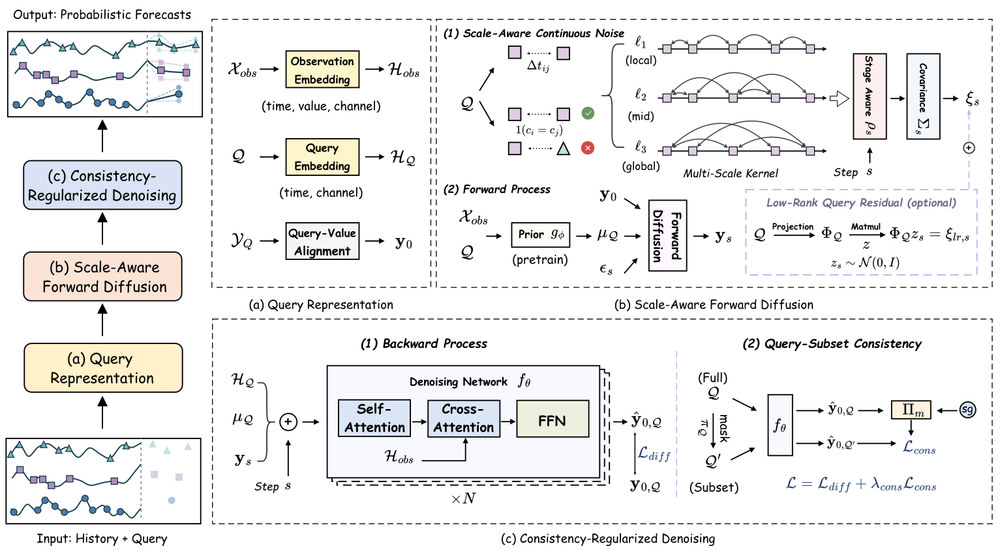
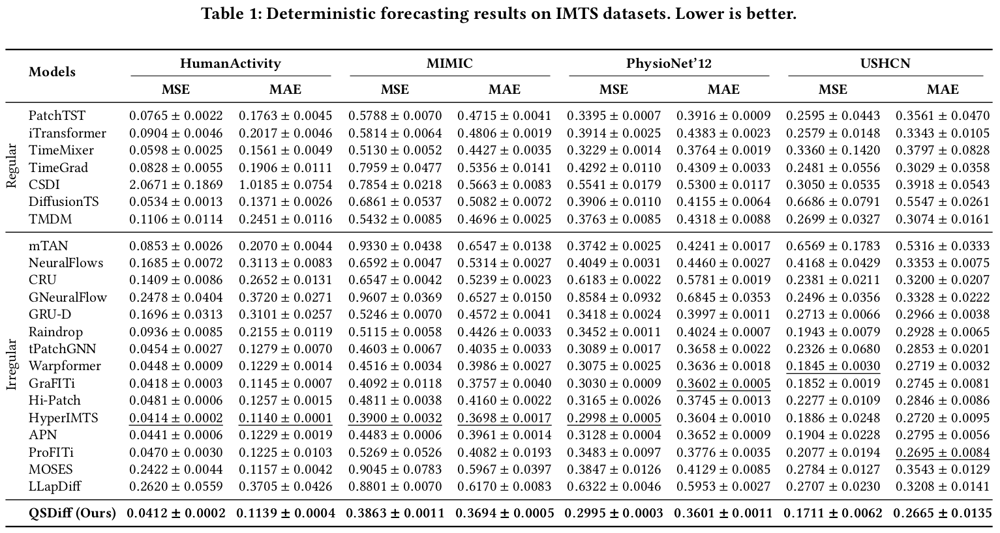
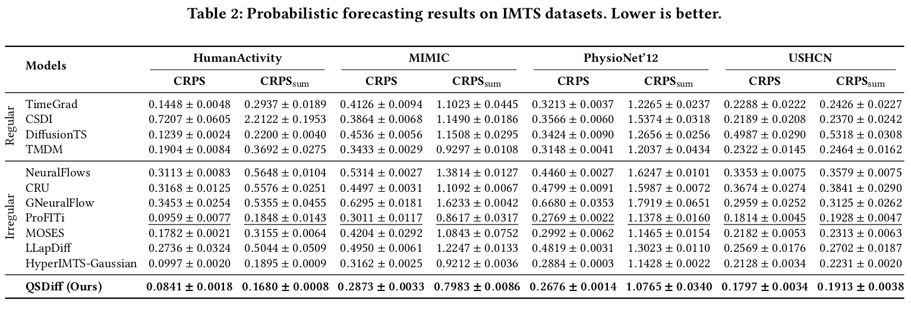

<h1 align="center">Query-Structured Diffusion for<br>Irregular Multivariate Time Series Forecasting</h1>

<p align="center"><b>KDD 2027</b></p>

## 📖 Overview

QSDiff forecasts irregular multivariate time series directly at the requested time–variable pairs. It uses physical time gaps to correlate noise across queries and encourages the denoiser to make consistent predictions when the query set changes. A pretrained forecaster can provide a prior mean for the diffusion process.

<p align="center">
  
  <br><sub>The QSDiff framework.</sub>
</p>

<p align="center">
  
  <br>
  
  <br><sub>Point and probabilistic forecasting results on four datasets (Tables 1 and 2 of the paper).</sub>
</p>

## 🚀 Quickstart

### 📦 Installation

Use Python 3.11. For CUDA 11.8, install PyTorch and the remaining dependencies with the following commands.

```bash
python -m pip install torch==2.6.0 --index-url https://download.pytorch.org/whl/cu118
python -m pip install -r requirements.txt
```

### 📂 Datasets

HumanActivity, PhysioNet’12 and USHCN download automatically on first use.

For MIMIC-III, place the preprocessed `complete_tensor.csv` in `~/.tsdm/rawdata/MIMIC_III_DeBrouwer2019/`. To build it from the credentialed MIMIC-III v1.4 files, run the preprocessing launcher and enter the directory containing the compressed CSV files. [MIMIC-III dataset](https://physionet.org/content/mimiciii/1.4/)

```bash
conda create -y -n qsdiff-mimic-prep python=3.7.13 numpy=1.21.6 pandas=1.3.5
conda run --no-capture-output -n qsdiff-mimic-prep python data/dependencies/MIMIC_III/preprocess/0_run_all.py
```

### ▶️ Training and inference

Run the script for the dataset of interest. Each script trains and evaluates five seeds. HumanActivity, MIMIC-III and PhysioNet’12 automatically train and cache their HyperIMTS priors.

```bash
bash scripts/HumanActivity.sh
bash scripts/MIMIC_III.sh
bash scripts/P12.sh
bash scripts/USHCN.sh
```

To select a GPU, prefix the command with `GPU_ID`, for example `GPU_ID=1 bash scripts/USHCN.sh`.

## 🏆 Acknowledgements

The data loaders and training pipeline build on [PyOmniTS](https://github.com/Ladbaby/PyOmniTS).
